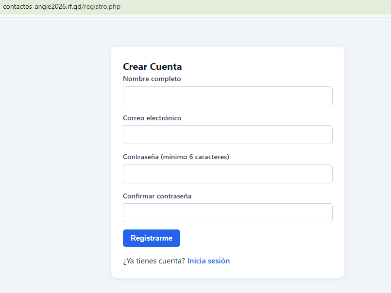
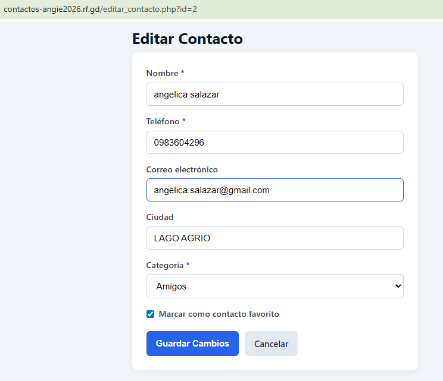
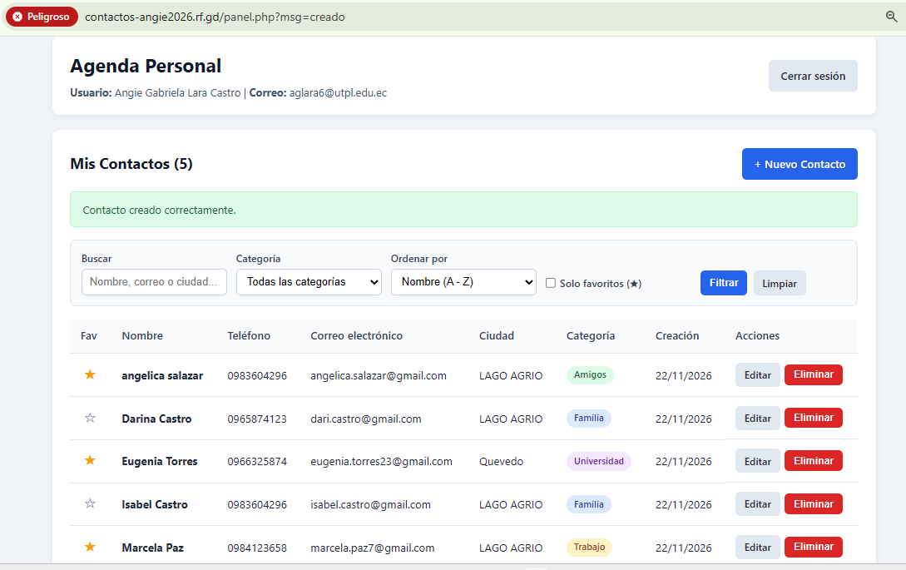

# 📒 Agenda Personal de Contactos (PHP & MySQL)

Aplicación web desarrollada en PHP y MySQL que implementa registro de usuarios, autenticación mediante sesiones y gestión privada de una agenda personal de contactos (CRUD), desplegada y operativa completamente en línea.

---

## 🌐 1. URL Pública
Accede a la aplicación en funcionamiento desde el siguiente enlace:
👉 **[http://contactos-angie2026.rf.gd/index.php](http://contactos-angie2026.rf.gd/index.php)**

---

## 📸 2. Capturas de Pantalla

### Inicio de sesión y registro de usuarios


### Panel principal y listado privado de contactos


### Registro y edición de contactos

---

## 🛠️ 3. Tecnologías Utilizadas
* **Backend:** PHP 8.x (PDO para acceso seguro a datos y control de sesiones).
* **Base de datos:** MySQL / MariaDB.
* **Frontend:** HTML5 y CSS3 responsivo (`assets/style.css`).
* **Servidor y Despliegue:** Apache (XAMPP/Laragon en entorno local y hosting gratuito en producción).
* **Control de Versiones:** Git y GitHub.

---

## 🚀 4. Detalle de las Mejoras Respecto a la Versión Anterior

1. **Despliegue en producción en la nube:** Migración de la aplicación desde un entorno exclusivamente local (`localhost`) hacia un servidor web en línea activo (`http://contactos-angie2026.rf.gd/index.php`), permitiendo el acceso remoto desde cualquier navegador.
2. **Sistema de autenticación y aislamiento de datos:** Implementación de registro e inicio de sesión (`registro.php`, `index.php`, `logout.php`) junto con control de acceso en `includes/auth.php`, garantizando que cada usuario visualice y administre únicamente sus propios contactos.
3. **Clasificación por categorías, ciudad y favoritos:** Ampliación del modelo relacional en `sql/database.sql` mediante la tabla `categorias` y los campos `ciudad` y `favorito` en `contactos`, permitiendo organizar y destacar registros de forma más completa.
4. **Seguridad con PDO e interfaz responsiva:** Uso de consultas preparadas (`PDO`) en `config/db.php` y en las operaciones CRUD (`crear_contacto.php`, `editar_contacto.php`, `eliminar_contacto.php`) para prevenir inyección SQL, junto con una estructura modular y diseño adaptable (`assets/style.css`).
---
   
## 💻 5. Instrucciones para Instalar el Proyecto Localmente

1. **Clonar o descargar el repositorio:**
   ```bash
   [git clone <URL-DE-TU-REPOSITORIO>](https://github.com/gabrielacastrosa127-crypto/agenda-personal-contactos-php.git)
